# Neural Networks | Labor 3 und 4

Ergebnisse des eigenen Neuronalen Netzes mit den MNIST- und Fashion-MNIST Datenbanken.

## MNIST: Training und Test

Das Netz verarbeitet 28 x 28 Pixel mit 784 Inputs, 32 Hidden Nodes und zehn Outputs für die Ziffern 0 bis 9. Trainiert wurde mit 60.000 Bildern aus der MNIST-Datenbank, einer Lernrate von 0,21 und einer Epoche.

Direkt nach dem Training wurden in einem Test 10/10 Ziffern richtig erkannt. Nach dem Schließen wurden die gespeicherten Gewichte in einem neuen Programmstart geladen, und es wurden wieder 10 von 10 richtig erkannt, ohne erneutes Training. Die beiden Gewichts-Matrizen liegen als Dateien vor.

**9.217 von 10.000 richtig = 92,17 %**

Für den 10.000-Bilder-Test wurden Gewichte aus einem zweiten Training mit allen 60.000 MNIST-Bildern geladen.

Die gleichen Antworten vor und nach dem Neustart sprechen dafür, dass Speichern und Laden der trainierten Gewichts-Matrizen funktioniert. Zehn Bilder sind dafür ein kurzer Funktionstest, wohingegen die 10000 Bilder eine deutlich aussagekräftigere Trefferquote liefern.

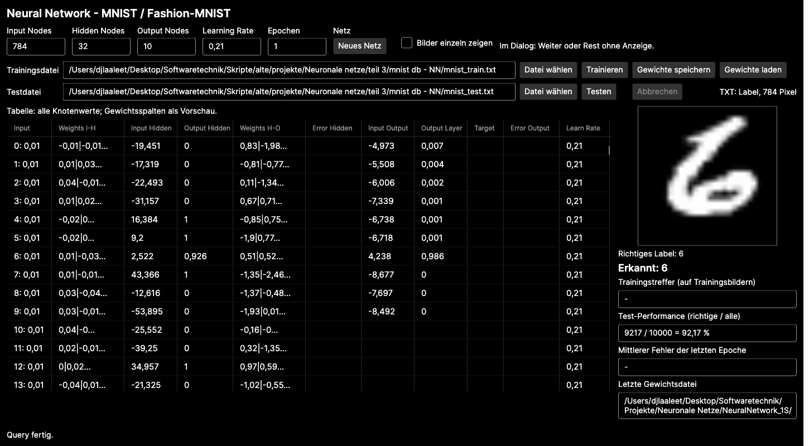

*Abb. 1: MNIST-Test mit 10.000 Bildern.*

*Gewichtsdateien zu Abb. 1 und dem Neustarttest:*  
*Projekt 3: `mnist_60k_lr0_21_h32_e1_20261112_194315.nnw`*  
*Projekt 4: `mnist_train-20261112-195159-093.nnw`*

## MNIST: Hyperparameter im Vergleich

Wir haben jeweils nur einen der drei Hyperparameter verändert. Alle sieben Trainingsläufe nutzten dieselben Bilder und den Zufallsstartwert 12345.

Die Konfiguration 0,21/32/1 taucht in allen drei Balkendiagrammen mit 91,07 % auf, weil sie die Default-Konfiguration ist. In Projekt 4 waren es 92,17 %, weil dieser Lauf mit anderen zufälligen Startgewichten begann. Für die Parametervergleiche wurde dagegen der feste Zufallsstartwert 12345 verwendet.

### Lernrate

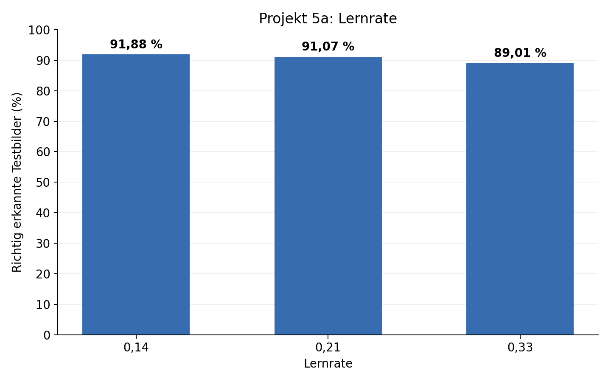

### Hidden Nodes

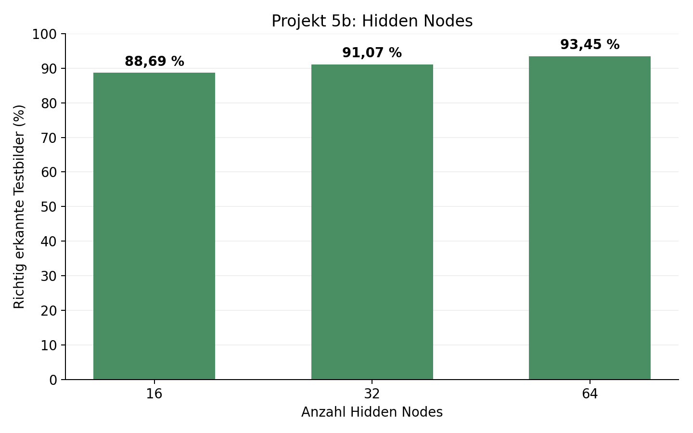

### Epochen

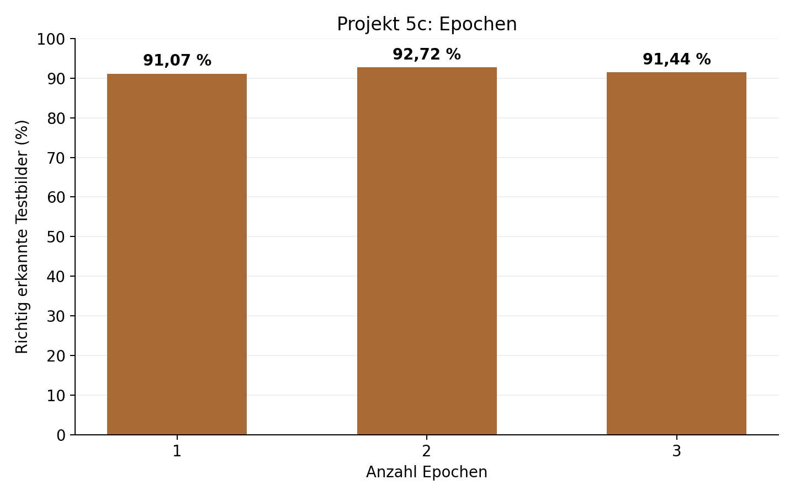

*Gewichtsdateien zu den sieben Trainingsläufen: `projects/Project5/results.csv`. Die Fehlerkurven wurden während der Läufe mit 1, 2 und 3 Epochen aufgezeichnet.*

Mit LR=0,14 war die Trefferquote höher als mit LR=0,21 oder LR=0,33. 64 Hidden Nodes waren besser als 16 oder 32. Bei den Epochen lag 2 vor 1 und 3.

Das zeigt merkbare Unterschiede für diese Werte, aber keinen allgemein besten Parameter.

## MNIST: Trainingsfehler

Beim Training berechnen wir für jedes Bild den halben quadratischen Fehler der zehn Output Nodes. Für die Fehlerkurven verwenden wir denselben Wert. Durch das Quadrieren fallen die Vorzeichen der Abweichungen weg, und große Abweichungen zählen stärker. Die zehn Werte werden zu einem einzigen Fehlerwert zusammengefasst:

**E = 1/2 · Σₖ₌₀⁹ (Zielₖ − Ausgabeₖ)²**

Der Faktor 1/2 vereinfacht beim Gradient Descent die Ableitung: Die 2 aus dem Quadrat fällt weg. Für die Kurve ist er nur ein Skalierungsfaktor. Ohne ihn wären die Fehlerwerte doppelt so groß, der Verlauf wäre aber derselbe.

Für den Output der richtigen Ziffer ist der Zielwert 0,99, für die übrigen neun 0,01. Alle 1.000 verarbeiteten Trainingsbilder tragen wir einen Punkt in die Kurve ein. Sein Wert ist der Durchschnitt der Fehler seit dem vorherigen Punkt. Zuerst für Bild 1 bis 1.000, dann für Bild 1.001 bis 2.000 usw. Dazwischen wird kein Punkt eingetragen. 

Ein kleinerer Wert bedeutet, dass die Ausgaben im Mittel näher an den Zielwerten lagen. Der Wert ist weder Fehlerquote noch Trefferquote. Dafür müsste man nur zählen, wie viele Bilder richtig oder falsch erkannt wurden. Auch zwei richtig erkannte Bilder können unterschiedliche Loss-Werte haben, wenn ihre Ausgaben unterschiedlich nah an den Zielwerten liegen.

### 1 Epoche

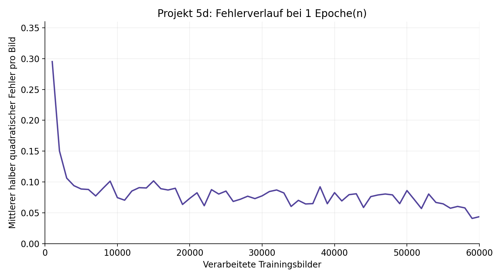

### 2 Epochen

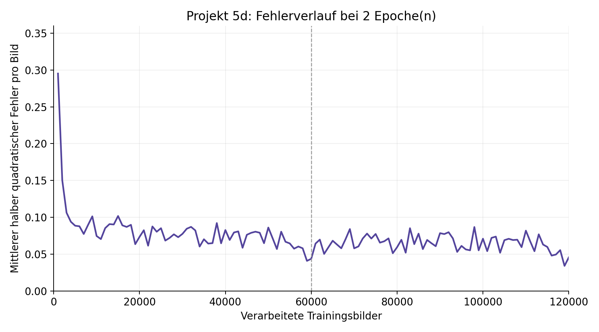

### 3 Epochen

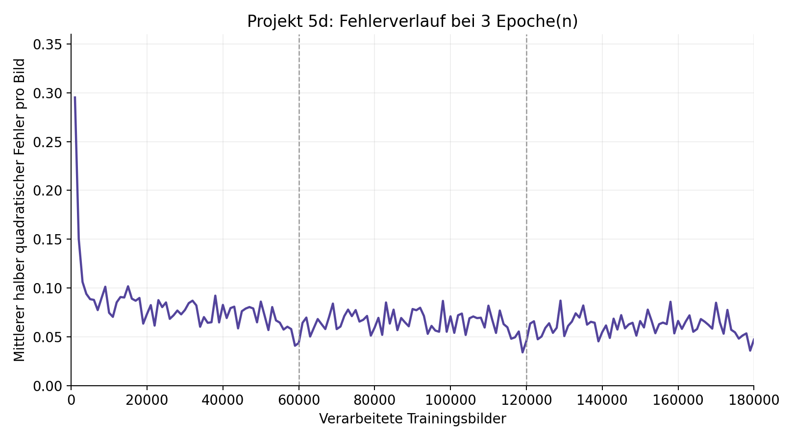

Der Trainingsfehler sank bei 3 Epochen weiter, die Testtrefferquote war aber niedriger als bei 2 Epochen. Weniger Trainingsfehler garantiert hier also nicht mehr richtige Tests.

## Fashion-MNIST: Training und Test

Fashion-MNIST hat ebenfalls Bilder mit 28 x 28 Pixeln. Die zehn Outputs stehen hier für Kleidungsarten statt Ziffern. Das Netz wurde mit 60.000 Bildern, 784/32/10 Nodes, Lernrate 0,21 und einer Epoche trainiert.

Von den ersten zehn Testbildern wurden nach dem Training 9 erkannt. Nach dem Neustart wurden nur die Gewichte geladen. Auf denselben zehn Bildern waren es wieder 9. Auch hier sind beide Gewichtsmatrizen als Dateien gespeichert.

**7.512 von 10.000 richtig = 75,12 %**

Für diesen Test wurden dieselben Gewichte wie in 6.3 geladen. Es wurde nicht noch einmal trainiert.

Die Trefferquote liegt unter der von MNIST. Für dieses einfache Netz scheinen manche Kleidungsarten schwerer zu unterscheiden zu sein. Der direkte Vergleich ist nur grob. Der MNIST-Lauf aus Projekt 4 hatte einen anderen zufälligen Gewichtsstart als der Fashion-Lauf.

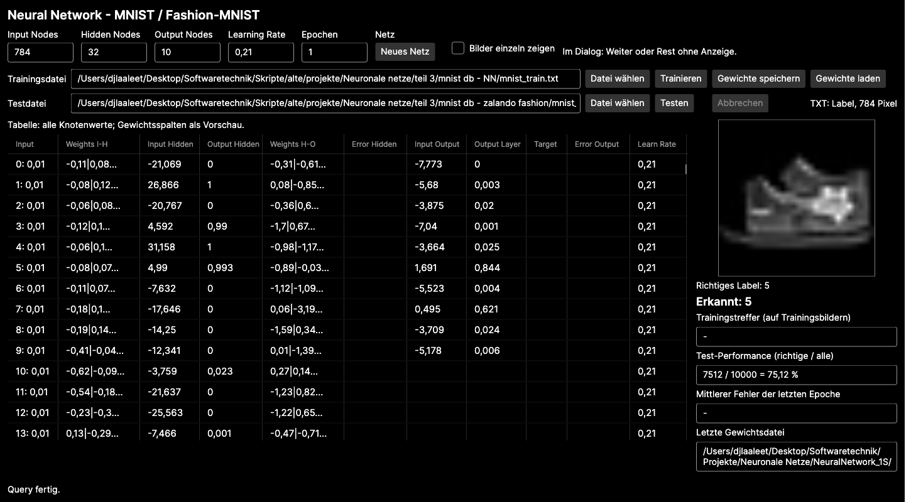

*Abb. 2: Fashion-Test mit 10.000 Bildern.*

*Gewichtsdatei für Projekt 6.3 und 6.4: `fashion_60k_lr0_21_h32_e1.nnw`.*

## Fashion-MNIST: Hyperparameter im Vergleich

Die gleichen sieben Konfigurationen wie bei MNIST wurden mit Fashion-MNIST trainiert. Pro Vergleich änderte sich nur ein Parameter.

Default-Konfiguration: Lernrate 0,21, 32 Hidden Nodes, 1 Epoche. Dieser Lauf verwendet dieselben Gewichte wie Projekt 6.4 und erreicht ebenfalls 75,12 %.

### Lernrate

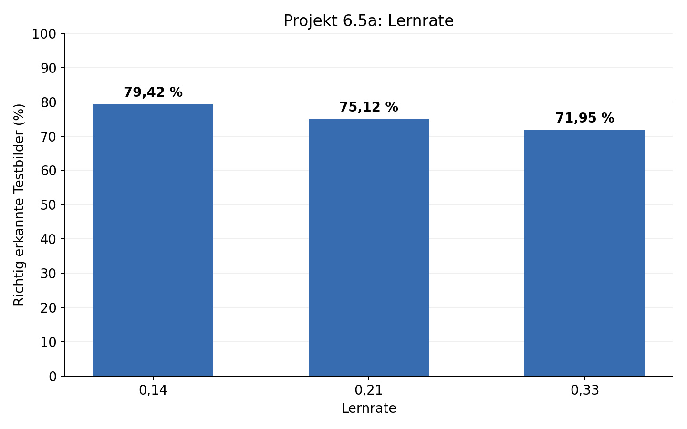

### Hidden Nodes

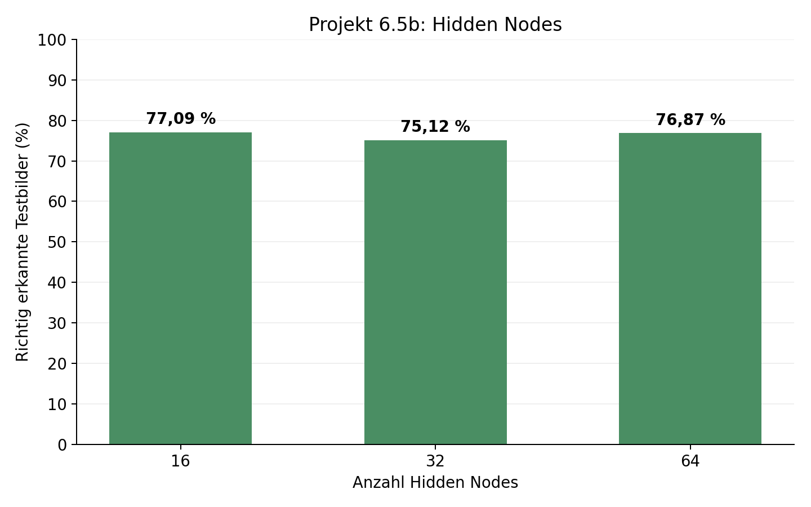

### Epochen

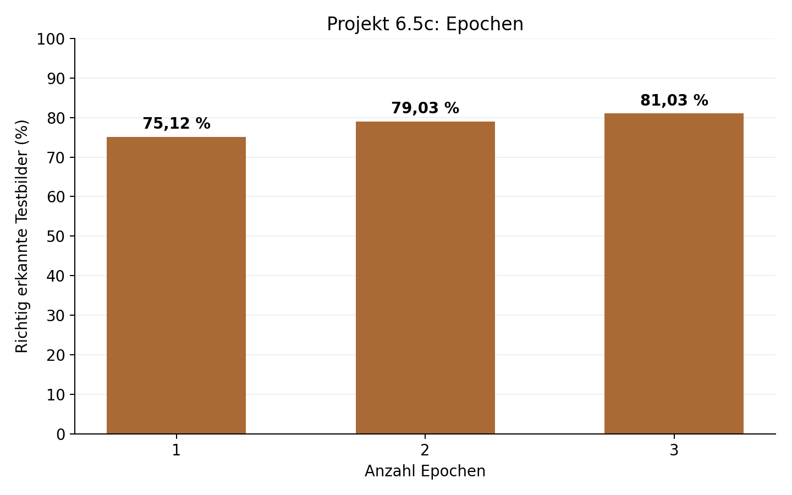

*Gewichtsdateien zu den sieben Trainingsläufen: `projects/Project6/6.5/results.csv`. Die Fehlerkurven wurden während der Läufe mit 1, 2 und 3 Epochen aufgezeichnet.*

Von den getesteten Lernraten war 0,14 am besten. Bei den Hidden Nodes lag 16 knapp vorn. Drei Epochen verbesserten die Trefferquote auf 81,03 %.

## Fashion-MNIST: Trainingsfehler und Fazit

Die drei Kurven zeigen dieselbe Loss-Funktion wie bei MNIST. Für ein Bild soll der Output der richtigen Kleidungsart 0,99 erreichen, die übrigen 0,01. Jeder Punkt ist wieder der Durchschnitt von 1.000 Trainingsbildern. Gestrichelte Linien markieren die Grenzen zwischen Epochen.

### 1 Epoche

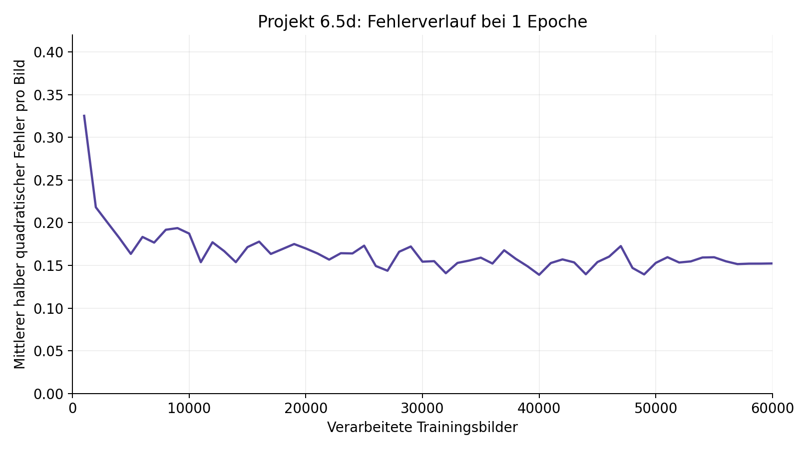

### 2 Epochen

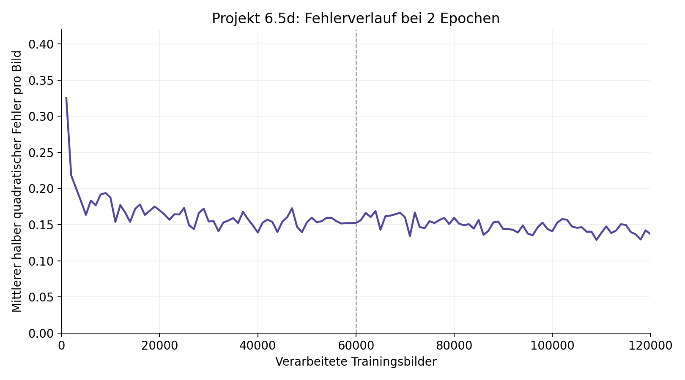

### 3 Epochen

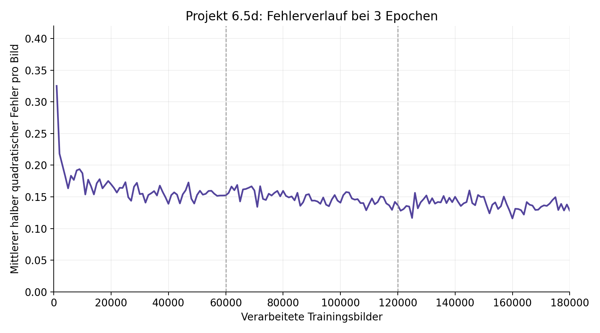

### Fazit

Die Gewichte ließen sich für beide Datensätze wieder laden: Nach einem Neustart wurden bei denselben zehn Testbildern genauso viele richtig erkannt wie davor. Im vollständigen Test erreichte das Netz 92,17 % bei MNIST und 75,12 % bei Fashion-MNIST.

Bei beiden Datensätzen war von den getesteten Lernraten 0,14 am besten. Bei MNIST waren 2 Epochen im Test am besten, bei Fashion-MNIST 3. Der Trainingsfehler sank zwar weiter, aber bei MNIST wurde die Trefferquote nach der zweiten Epoche wieder schlechter. Mehr Hidden Nodes halfen auch nicht immer: Bei MNIST lagen 64 vorn, bei Fashion-MNIST 16 knapp vor 64.

Die sieben Läufe reichen nicht für ein allgemeines Optimum. Selbst alle 3 × 3 × 3 = 27 Kombinationen würden nur die beste Kombination aus unseren drei Lernraten, drei Hidden-Node-Zahlen und drei Epocheneinstellungen zeigen. Um zum Beispiel die Lernrate genauer festzulegen, müssten wir einen größeren Bereich mit feineren Abstufungen systematisch testen und mehrere zufällige Startgewichte vergleichen. Bisher sehen wir außerdem nur die gesamte Trefferquote und den mittleren Loss. Für eine genauere Fehlerauswertung wäre interessant, welche Ziffern oder Kleidungsarten häufig verwechselt werden.
